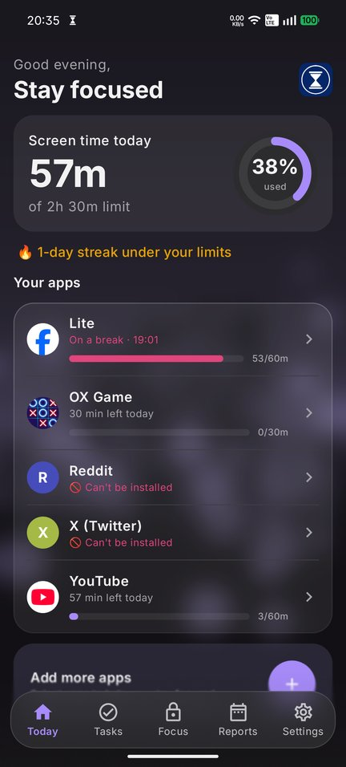
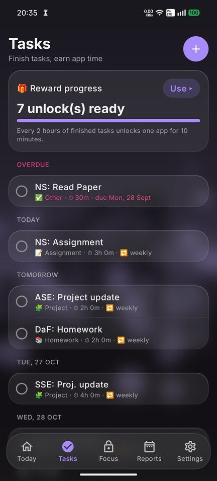
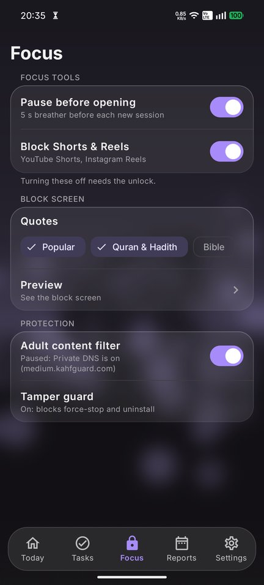
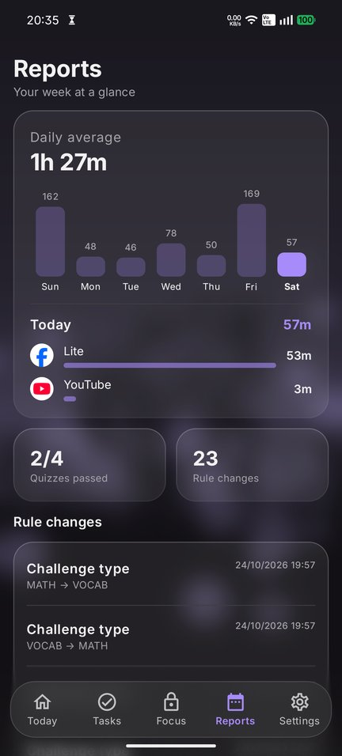
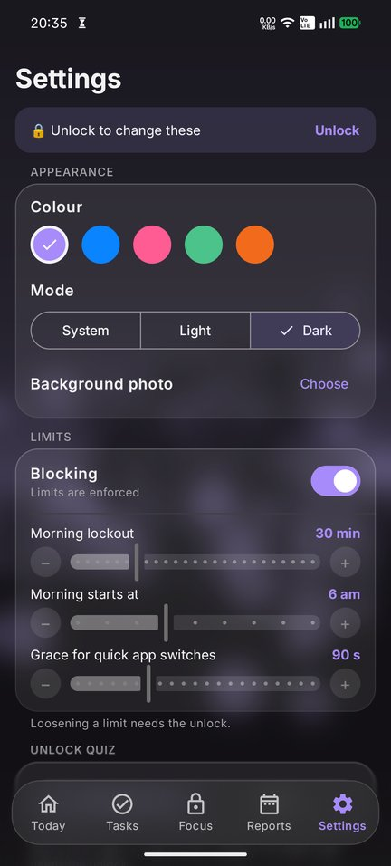
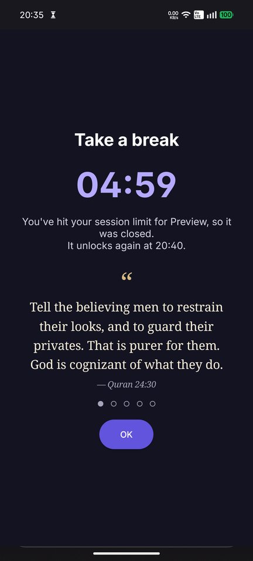

# Social Blocker

An Android app that keeps social media in check. Set time limits per app, and when time is up the app is closed, not just covered.

<p align="center">
  
  
  
</p>
<p align="center">
  
  
  
</p>

## Features

**Limits**
- **Session limit:** after N minutes of use, the app takes a break for M minutes.
- **Daily limit:** after N minutes in a day, the app is blocked until midnight.
- **Opens per day:** cap how often an app can be opened.
- **Morning lockout:** no social apps for the first part of your morning (start hour is configurable).
- **Can't-install list:** block apps you don't even have installed yet.

**When time runs out**
- A floating timer counts down while you use a limited app, with a 10 s warning before it closes.
- The app is closed (picture-in-picture included) and a block screen shows the time left and a rotating quote: Popular, Quran & Hadith, or Bible.

**Focus tools**
- **Pause before opening:** a 5 s breather before each new session.
- **Block Shorts & Reels:** backs out of YouTube Shorts and Instagram Reels; the rest of the app keeps working.
- **Adult content filter:** a DNS filter (Cloudflare for Families) that runs on the phone.
- **Tamper guard:** stops the app from being force-stopped or uninstalled from Settings.

**Staying honest**
- Loosening any limit needs an **unlock quiz** (German vocabulary or math) or a 10-minute wait.
- **Tasks with deadlines** (weekly repeats supported). Every 2 hours of finished tasks earns a 10-minute unlock.
- **Reports:** a weekly chart (tap a day for per-app time), quiz results and a log of every rule change.

**Looks**
- Frosted-glass design with five accent colours, light and dark mode, and an optional background photo.

## Install

Requires Android 13 or newer.

```sh
export JAVA_HOME="/Applications/Android Studio.app/Contents/jbr/Contents/Home"
./gradlew :app:assembleDebug
adb install -r app/build/outputs/apk/debug/app-debug.apk
```

Open the app and follow **Setup**. It asks for:

| Permission | Why |
|---|---|
| Usage access | See which app is open |
| Display over other apps | Show the timer and block screen |
| Notifications | Status and task reminders |
| Unrestricted battery | Keep running in the background |
| Accessibility (optional) | Tamper guard, Shorts & Reels blocking |
| VPN (optional) | Adult content filter |

### Toggle greyed out ("Restricted setting")

Android restricts some permissions for apps installed from an APK. Open **App info → ⋮ → Allow restricted settings**, then grant them again. Or, over USB:

```sh
adb shell appops set ch.puc.blocker ACCESS_RESTRICTED_SETTINGS allow
```

## Good to know

- The block kicks in within about a second, so a blocked app may flash briefly.
- Android 14+ doesn't let one app kill another, so a blocked app is sent to the background and its media is paused. Reopening it closes it again.
- Some phone makers (Xiaomi, Samsung, OnePlus…) kill background apps aggressively. Allow autostart and "no restrictions" ([dontkillmyapp.com](https://dontkillmyapp.com)).
- The adult content filter pauses itself while Private DNS is set, since Private DNS takes over all lookups.
- It's a self-control tool, not a lock: revoking permissions or changing the clock gets around it.

## Development

```sh
./gradlew :app:testDebugUnitTest
```

| Path | What's there |
|---|---|
| `domain/` | Pure logic with unit tests: rules, quiz, rewards, quotes, DNS packets |
| `data/` | Room database |
| `service/` | Blocker (foreground service), accessibility guard, DNS filter, notifications |
| `overlay/` | Timer, block screen, pause screen |
| `ui/` | Jetpack Compose screens and theme |
